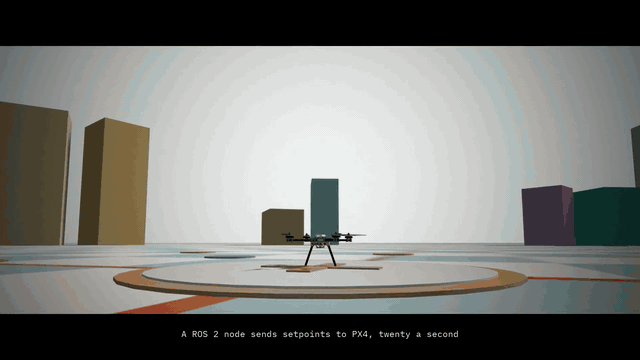
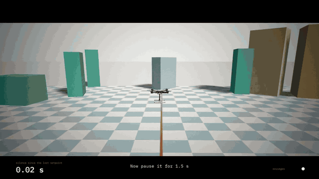
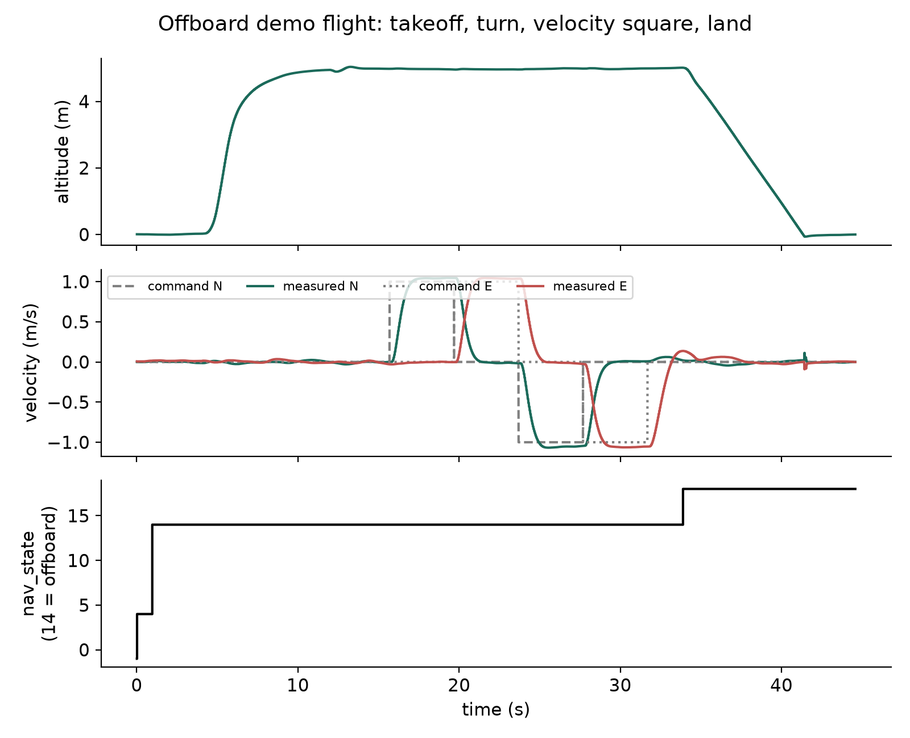
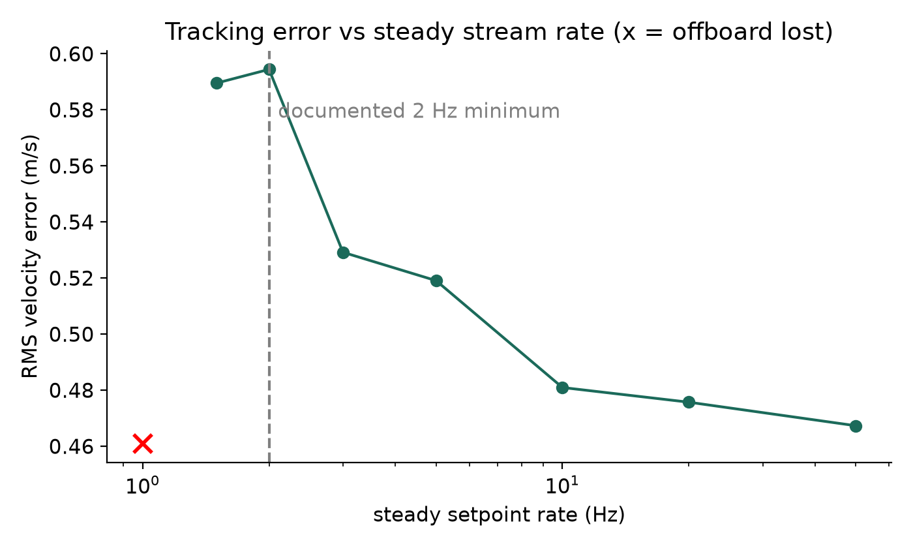
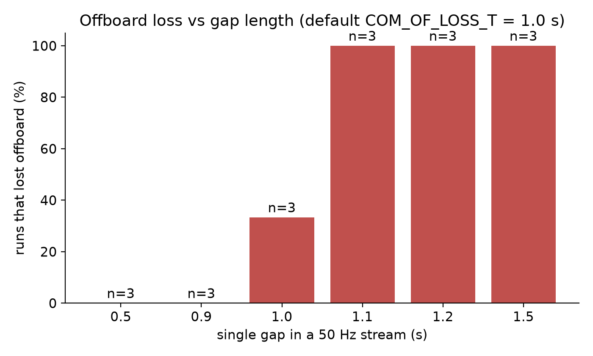
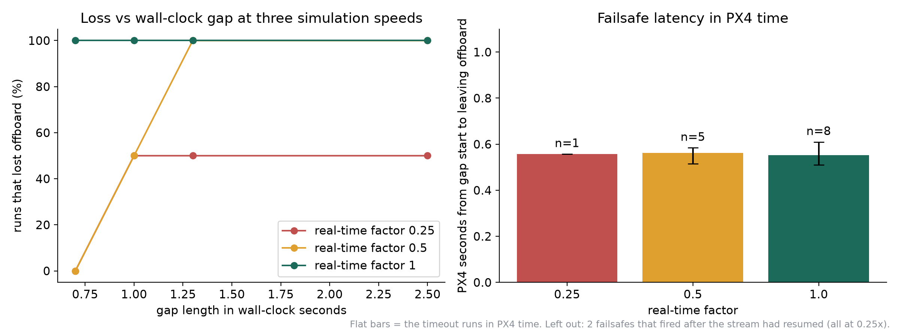

# px4-offboard-timing-study

PX4 SITL offboard flight control from ROS 2 (Jazzy, Gazebo Harmonic x500), plus a measurement of how the quality of the
setpoint stream (rate, gaps, jitter, CPU load, simulation speed) affects offboard mode and tracking.

Start with `FINDINGS.md` for the results and their caveats. `RESEARCH_QUESTION.md` has the original question, the
literature gaps and future work.

## Demo

[](results/videos/PX4_Offboard_Cinematic_silent.mp4)



- **Cinematic cut, 78 s:** [silent](results/videos/PX4_Offboard_Cinematic_silent.mp4), or
  [with a drone sound synthesised from the flight log](results/videos/PX4_Offboard_Cinematic_drone_sound.mp4).
  A joystick flight, then the command stream is paused twice: 0.6 s (PX4 waits) and 1.5 s (PX4 takes the drone back).
- **Analysis cut, 138 s:** [white background](results/videos/PX4_Offboard_Analysis_White.mp4). The same flights with the
  gamepad, the silence counter against PX4's 1.0 s timeout, captions and three plots synced to the logs.
- **The whole story** (what this is, why I built it, the technical challenges and how I solved them, what I learned):
  [PROJECT_STORY.md](PROJECT_STORY.md).
## Results (simulation, small samples; read the caveats in FINDINGS.md)

**Demo flight.** Arm, offboard, climb to 5 m, hold, 90 degree turn, velocity square, land. Stream at 20 Hz, offboard never lost.



**Rate versus tracking error.** The error rises as the steady stream rate falls, long before any failsafe. 1 Hz lost offboard, 1.5 Hz and above did not.



**One gap in a 50 Hz stream.** Gaps up to 0.9 s were tolerated, 1.1 s and longer always lost offboard (default timeout 1.0 s, n=3 per bar).



**Simulation speed.** The failsafe counts PX4's own time, not wall time. The sweeps in this figure ran before the timeout parameter was pinned, so the absolute value is not the default (FINDINGS.md, section 3).



## What is in here

| Path | Content |
|---|---|
| `ros2_ws/src/px4_offboard_study/` | ROS 2 package. `study_node`: arm, offboard, takeoff, hold, yaw turn, velocity square, land, with configurable stream degradation and a 100 Hz CSV log. `teleop_node`: joystick or keyboard, deadzone, limits, body frame to NED. `common.py`: PX4 QoS, publishers, commands. `mathutil.py`: pure maths with unit tests. |
| `experiments/` | `run_experiments.py` (experiment plans), `analyze.py` (tables, figures), `run_plan.sh`, `run_all.sh`, `teleop_driver.py` (scripted gamepad). |
| `video/` | Gazebo world, camera operator, recording session scripts, and the video composers (`compose_final.py`, `compose_cinema.py`, `cine_audio.py`). |
| `setup/` | `setup_sudo.sh`, `build_px4.sh`, `sync_msgs.sh`: environment setup in Ubuntu 24.04 WSL. |
| `tools/` | Small clock and environment checks used while debugging (see its README). |
| `results/` | All logs and figures, see `results/README.md`. |


## What the demo does

1. Streams `OffboardControlMode` and `TrajectorySetpoint` at 20 Hz before the mode switch (PX4 refuses offboard otherwise).
2. Switches to offboard, arms, climbs to 5 m, holds, turns 90 degrees.
3. Flies a 4 m velocity square (1 m/s legs), then lands.

PX4 topics are best effort and volatile; the nodes use the same QoS or nothing arrives.

## Run it (Ubuntu 24.04 in WSL2, ROS 2 Jazzy)

```bash
bash setup/setup_sudo.sh          # apt packages and Gazebo (needs sudo)
bash setup/build_px4.sh           # PX4 SITL, Micro XRCE-DDS agent, px4_msgs (30+ minutes)
bash setup/sync_msgs.sh     # make px4_msgs match the PX4 source
# build the package
mkdir -p ~/study_ws && cp -r ros2_ws/src ~/study_ws/ && cd ~/study_ws
source /opt/ros/jazzy/setup.bash && source ~/px4_ws/install/setup.bash && colcon build
# one clean demo flight (starts simulator, agent, node; writes CSV and JSON)
cd experiments && python3 run_experiments.py final
```

Topic names carry message versions in this PX4 build; if they differ in yours, check `ros2 topic list -t` and edit
`common.py`.

## Videos (real Gazebo footage)

Three flights recorded from the Gazebo window (joystick, stream paused for 0.6 s, stream paused for 1.5 s), edited two ways.
The raw recordings are not in git (large, and a desktop capture can pick up other windows); the flight logs are in
`results/showcase_raw` and `results/cinematic_raw`.

- **Analysis cut** (`video/compose_final.py`, palettes A black and D paper): footage, gamepad, silence counter, captions and
  three plots synced to the logs. Typeface: IBM Plex Mono (`video/assets/fonts`, SIL Open Font License).
- **Cinematic cut** (`video/compose_cinema.py`): 2.39:1 letterbox, a restrained grade, slow motion at the key moments, a
  scripted camera operator (`video/camera_director.py`: tilt-up, chase, orbit, top-down, push-in). One version has a drone
  sound synthesised from the flight log (`video/cine_audio.py`): blade-pass pitch from the logged thrust and acceleration,
  four detuned motors, louder and brighter when the camera is close.

```bash
# in Ubuntu WSL: world and texture, then simulator, agent and GUI on the AMD GPU
bash video/install_showcase.sh && WORLD=showcase bash video/gui_session.sh
bash video/gui_act.sh teleop A_teleop               # or: gui_act.sh gap B_gap0.6 0.6
# in Windows: record the Gazebo window with ffmpeg ddagrab (nothing else may be on top of it), then
python video/compose_final.py full A out_A.mp4      # or D
python video/compose_cinema.py full out_cinema.mp4
```

`GALLIUM_DRIVER=d3d12` (set by the scripts) renders on the GPU; without it WSL falls back to the CPU and the window runs at
about 4 frames per second. The world (`video/make_showcase_world.py`) keeps everything that stands up far from the flight
path, so the follow camera never has something between it and the drone.
## Tests

```bash
cd ros2_ws/src/px4_offboard_study && PYTHONPATH=. pytest -q test   # 9 tests, no ROS needed
```

CI runs the same on every push (`.github/workflows/test.yml`).

## Status and limits

- Everything is simulation. One vehicle model, one laptop, small samples (2-3 runs per condition).
- The WSL2 clock on this machine is unstable (wall clock stepped back about 2.5 s every 32 s). The nodes use steady-clock
  timers and PX4-anchored timestamps for that reason; see `FINDINGS.md` section 4.
- The large sweeps in `run2` and `run4` did not pin `COM_OF_LOSS_T`; `FINDINGS.md` section 3 explains what that means.
- Teleop was flown with scripted joystick messages, not a physical gamepad.
